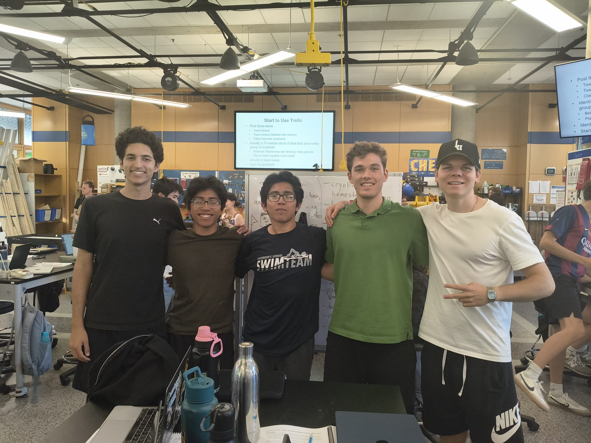

# Cord-Blood-Bag-Egr101
5 Guys Repository Cord Blood Bag Egr101

#CAD
https://cad.onshape.com/documents/41fd1448b1f5bff0b83bb050/w/23750a3260a4f583946c9f5e/e/65ef8fd63a5dfbd59b9caa9c?renderMode=0&uiState=6afe0a8c90390abc0541e348

Group: Logan Pacheco, Kyle Pacheco, Vladimir Kolev, Dimitar Fidanovski, Alex Bubnov

Acknowledgements: Dr. Saterbak, Pamy Noldner, Duke Marcus Center Cord Blood, TA Ananya

Repository made by Logan Pacheco 
Contact:

logan.pacheco@duke.edu

https://www.linkedin.com/in/logan-pacheco/
